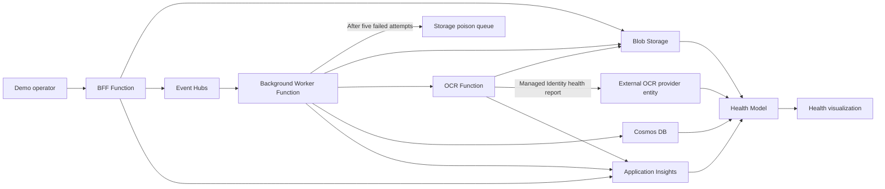

# Azure Monitor Health Models — Demo Environment Design

ExpenseFlow is a small receipt and expense processing workload used to demonstrate health-model behavior. It accepts synthetic expense submissions, publishes them to Event Hubs for background processing, calls a simulated OCR service, stores the resulting expense record, and emits real platform telemetry. The health model uses Event Hubs platform metrics and Worker logs to monitor messaging and processing failures.

## Application Flow

## Tooling
- **Bicep** defines both the infrastructure and the health model.
- Single, repeatable deployment; no manual portal steps.

## Observability
- Application Insights is enabled for all Functions and backed by a central Log Analytics workspace.
- Telemetry ingestion/query access uses Azure Monitor Private Link and private DNS; public ingestion/query paths are disabled where supported.
- The OCR Function uses a dedicated user-assigned managed identity to submit external OCR provider health reports directly to the health model.

## Security & Compliance Baseline
All resources must comply with a restricted enterprise environment:
- **No public/open endpoints** — private access only.
- **No key-based authentication** — use Managed Identity / Entra ID (RBAC).
- **Demo exception:** the worker → OCR Function internal call starts with a Function key stored in Key Vault and exposed to the worker through a Key Vault reference while the endpoint remains private-only; revisit Entra-based auth if the demo needs stricter parity with managed-environment rules.
- **VNET-integrated** with **NSGs** governing traffic.
- Private endpoints for PaaS services where applicable.
- Least-privilege RBAC throughout.

## Resource Categories
1. **Static (locked-down) resources** — fully locked down, do nothing but appear in the health model as monitored entities.
2. **Live resources** — actively used to demonstrate health concepts (e.g. emitting signals, processing queue messages, changing health state).

## Health Model
- Authored in Bicep over the provisioned resources.
- Composed of monitored entities and their relationships, producing aggregated health states for the demo.

### Messaging and processing signals
The Event Hubs entity remains under `Data layer`. It monitors native `ThrottledRequests`, `ServerErrors`, and `UserErrors` metrics, using five-minute totals. Greater than zero is Degraded; greater than five is Unhealthy. Resource Health is disabled on this entity; its signals use Azure Monitor metrics.

The Worker retains its activity and OCR failure signals. A `Poison handoffs` signal counts its poison-queue error logs over ten minutes and becomes Unhealthy above zero. The query requires Worker traces before returning a value, so absent telemetry does not become a healthy zero. This is a recent-failure signal, not a count of unresolved poison messages. A successful Worker invocation can represent either processing success or a poison handoff.

These signals do not measure queue depth, consumer lag, or end-to-end expense completion. Event Hubs incoming minus outgoing events is not a valid processing backlog calculation.

### External health reporting
The model includes an `OCR provider (external)` entity for demonstrating application-supplied health through the `ingestHealthReport` API. The OCR Function hosts a timer-triggered reporter and uses a dedicated user-assigned managed identity with `Contributor` access scoped to the health model.

- **Schedule:** the heartbeat runs every 10 seconds by default.
- **Reporting probability:** each run has a configurable probability of sending a report; the default is `0.35`.
- **Reported state:** the reporter sends the configured `Healthy`, `Degraded`, `Unhealthy`, or `Unknown` state. It does not infer provider health from OCR failures.
- **Expiry:** reports expire after two minutes by default. If no new report arrives, the entity becomes `Unknown`, not `Unhealthy`.
- **Live demo lever:** set the reporting probability to `1` and change the configured state to force a deterministic health transition and propagation through the model.

### Auto-discovery (regional policy configuration)
The deployment creates a dedicated **regional policy configuration health model** with an Azure Resource Graph discovery rule (`regional-policy-config`). The main ExpenseFlow health model represents this dedicated model as one Azure resource entity, which keeps discovery-generated entities outside the hand-authored application model.

- **What is discovered:** a fleet of **Azure App Configuration** stores, each representing a region's ExpenseFlow expense policy (approval thresholds, per-diem limits, VAT handling, allowed currencies). The Functions would load the caller's regional store at runtime to decide how to process an expense.
- **Scope:** the rule's ARG query matches only stores tagged `component=policy-config`. A pre-created `regional-policy-config` generic entity is connected to the dedicated model root and acts as the discovery parent. The main model contains only its reference entity.
- **Signals:** recommended signals and an Azure Resource Health availability signal are added automatically to every discovered store.
- **Dynamic behavior:** discovery runs every ~5 minutes, so adding or removing a tagged store is reflected automatically. Each store is deployed to its own Azure region (Free tier, one per region) to match the regional narrative.
- **Live demo lever:** setting `enableDemoPolicyConfigRegion = true` provisions an extra regional store that the model auto-discovers within a few minutes, showing discovery reacting to a growing environment.

## Scenario — ExpenseFlow
A receipt/expense processing app that exercises the full architecture and gives an intuitive, linear flow to narrate health propagation.

**Flow:** submit expense → event stream → background processing → OCR microservice → store results.

**Components:**
- **BFF Function** — serves the control panel/web UI: submit expenses, list status.
- **Background Function** — consumes expense events, orchestrates processing, writes results, and saves failed messages to a poison queue.
- **OCR Microservice Function** — dedicated extraction service: reads a receipt image, returns structured data.
- **Event Hubs** — Standard tier with one throughput unit, two partitions, seven-day retention, and a dedicated worker consumer group. Native Function bindings provide publishing, consumption, checkpoints, and retries.
- **Azure Storage** — blob storage for receipt images and a private Storage Queue for failed expenses.
- **Database** — expense records and approval state.

**Health story:** when the OCR microservice degrades, retries pause the affected Event Hubs partition until processing succeeds or the failed expense is saved to the poison queue. OCR failures and poison handoffs affect Worker health; native transport errors affect Event Hubs health. Processing lag needs separate telemetry and is not inferred from transport traffic. The external OCR provider can still report an explicit unhealthy state, demonstrating direct health ingestion and propagation.

**Demo levers (control panel):** flood the queue, take down the OCR microservice, throttle storage, and force health-state changes to show propagation.

## Simulation Model
Keep the plumbing real, simulate the work. All Functions, Event Hubs, Storage, and the database are real and genuinely exercise each other, but receipt/OCR work is faked. No files are uploaded and no real OCR runs.

- **Synthetic submissions** — the BFF generates a fake expense (random vendor, amount, category) and writes a small JSON "receipt" blob to Storage (trivial, so done for real), then publishes an event.
- **Keep-alive timer** — a timer-triggered function in the BFF app periodically creates synthetic submissions so Event Hubs, the worker, OCR service, storage, database, and telemetry keep producing signals even when no one is using the control panel.
- **Simulated OCR** — the microservice waits a configurable delay and returns canned/random structured data; no image processing.
- **External health reporter** — a timer in the OCR Function probabilistically sends the configured external provider state to the health model; missing reports expire to `Unknown`.
- **Simulated processing** — the background Function reads an event, waits a configurable interval, calls the OCR service, and writes the expense record to the database. After five failed processing attempts, it saves the message to `expenses-poison`. The checkpoint advances only after processing or poison storage succeeds. Real I/O, no real compute.
- **Config-driven behavior** — per-component latency, failure rate, and health state come from app settings / control-panel signals, so the flow is fully steerable without real data.

This produces genuine event traffic, storage operations, and processing failures. Native Event Hubs metrics and poison-handoff logs supply the messaging health signals; consumer lag is not measured.

## Control Panel UI
A simple UI to drive the demo:
- Invoke health-state changes.
- Send messages into queues.
- Trigger other signals consumed by the live resources.

Must honor the same security baseline (no open endpoints, identity-based auth).

## Approach
Start from this baseline and layer in specifics incrementally (concrete resource list, health model structure, control panel design) in later iterations.
